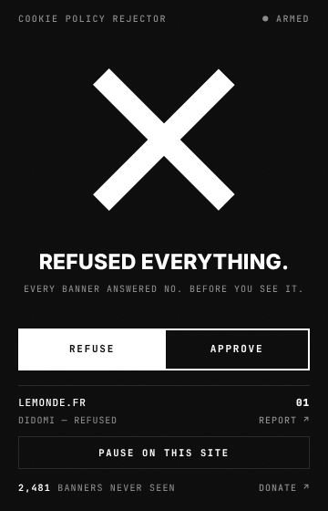
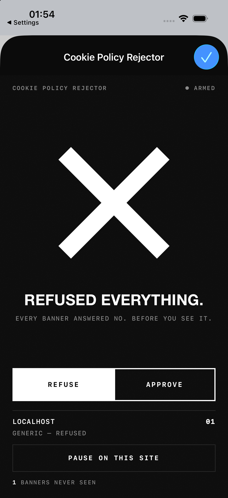

# Cookie Policy Rejector

[](https://github.com/Ewi0/cookiePolicyRejectorRD/actions/workflows/ci.yml)

**REFUSED EVERYTHING.** A browser extension that answers every cookie banner before it paints. It refuses by default; switch it to **APPROVE** and it accepts everything instead. Either way, you never see a banner.

Matte black, one massive white X, nothing rounded. Approve mode morphs the X into a check.

| MacBook · Chrome | iPhone · Safari (real build, iOS Simulator) |
| --- | --- |
|  |  |

Full interface board (MacBook, iPhone, the iOS companion app, Firefox on Android, every state, icons): [`assets/screenshots/mockups.png`](assets/screenshots/mockups.png). To view it live, run `npm run serve` and open <http://127.0.0.1:4173/mockups/>.

## What it does

- **Refuse mode (default):** presses "Reject all" / "Only necessary" / "Ablehnen" / "Tout refuser" and so on. If the first layer has no reject button, it opens the settings layer and rejects or unticks everything there. If there is no way to refuse (an info-only notice or a pay-or-consent wall), it **hides the banner without answering**: no consent is given and the page is usable.
- **Approve mode:** presses "Accept all" / "Allow all" / "Alle akzeptieren" and so on.
- **Never seen:** known consent platforms are hidden by a stylesheet injected at `document_start`, so they never paint. Unknown banners are found as soon as they are inserted and hidden before the next frame.
- **Never presses the wrong thing:** policy links, "Learn more", vendor lists, and paywall exits ("Reject all and subscribe", "Subscribe now", "Log in") are on a never-press list. Sign-in or newsletter dialogs that mention cookies are left alone.
- **Never misses a page:** a full scan starts at the end of the page, where banners are appended, so long pages (documentation, code) don't hide them. Boxes that are revealed rather than inserted are caught the moment they show. Consent tools that load late (on first scroll, after a delay) are still answered. Right after installation it also starts in tabs that were already open.
- **An honest popup:** if a page loaded before the extension, or the browser hasn't given it access to the site, the popup says so and fixes it with one tap.
- **Pause per site**, a toolbar badge (banners answered on this tab, or `OFF`), and a lifetime "banners never seen" tally.
- **31 languages** for the popup and the store listing, with each language's plural rules and number format.
- **Private by design:** no network requests, no analytics, no accounts. Settings live in `storage.local` and nothing leaves the browser. What it reads, what it stores and why it asks for access to every site: [PRIVACY.md](PRIVACY.md).

Coverage: 48 rules for known platforms (OneTrust, Cookiebot, Didomi, Usercentrics, Sourcepoint, InMobi/Quantcast, TrustArc, Google Funding Choices, Osano, CookieYes, Complianz, iubenda, Klaro, Axeptio, Borlabs, consentmanager, Termly, Shopify, HubSpot, Wix, Squarespace, Amazon, Microsoft, LinkedIn, YouTube/Google consent pages and more). A generic detector handles everything else in about 25 languages, including open and closed shadow DOM and consent iframes.

## Get it

Free, and the same on every device whose browser can run extensions.

| Device | Browser | Get it from |
| --- | --- | --- |
| Windows, Mac, Linux, Chromebook | Chrome, Brave, Vivaldi, Opera, Arc | Chrome Web Store |
| Windows, Mac, Linux | Microsoft Edge | Edge Add-ons |
| Windows, Mac, Linux | Firefox, LibreWolf, Zen, Waterfox, Floorp | Firefox Add-ons |
| Mac | Safari | Mac App Store |
| iPhone, iPad | Safari | App Store |
| iPhone, iPad, Mac | Orion (extensions on iPhone and iPad are in beta) | Chrome Web Store or Firefox Add-ons |
| Android phone or tablet | Firefox | Firefox Add-ons |
| Android phone or tablet | Lemur, Quetta and other browsers that install Chrome extensions | Chrome Web Store |

Store links appear in this table as each listing goes live. Until then, every [release](https://github.com/Ewi0/cookiePolicyRejectorRD/releases) has ready-made packages you can install by hand, as described below.

**Can't run it:** Chrome on Android, iPhone and iPad, Samsung Internet, and most other iPhone browsers don't allow extensions. Edge for Android only offers a short list of extensions that Microsoft picks.

## Install from source: computers

For testing and development. Everyone else: use the stores above.

**Chrome, Edge, Brave, Arc, Opera, Vivaldi**
1. Open `chrome://extensions` (Edge: `edge://extensions`) and turn on **Developer mode**.
2. Click **Load unpacked** and pick the `extension/` folder.
3. Pin the X to the toolbar.

**Firefox**
1. Run `npm run build`.
2. Open `about:debugging#/runtime/this-firefox` → **Load Temporary Add-on…** → pick `dist/firefox/manifest.json`.
3. For a permanent install, sign the zip through addons.mozilla.org. This works for Firefox for Android too.

**Safari (macOS)**
1. Open `safari/Cookie Policy Rejector/Cookie Policy Rejector.xcodeproj` in Xcode.
2. Pick the **Cookie Policy Rejector (macOS)** scheme and Run.
3. In Safari: **Settings → Advanced → Show features for web developers**, then **Develop → Allow Unsigned Extensions**.
4. **Settings → Extensions** → enable Cookie Policy Rejector → **Always allow on every website**.

## Install from source: phones and tablets

**iPhone / iPad (Safari)**
1. Open the Xcode project, pick **Cookie Policy Rejector (iOS)**, set your team under *Signing & Capabilities* for both iOS targets, and run on your device. The iOS Simulator works without a team.
2. On the phone: **Settings → Apps → Safari → Extensions → Cookie Policy Rejector** → **Allow Extension**, then **All Websites → Allow**.
3. In Safari, the extension menu in the address bar shows **Rejector** with a badge. Tap it for the popup.

This flow was checked end to end on an iPhone 17 Pro simulator (iOS 26.5): the ReactDesk banner never appeared and the popup showed `LOCALHOST · 01 · GENERIC — REFUSED`.

**Android**
- **Firefox for Android:** publish `dist/cookie-policy-rejector-firefox-*.zip` on AMO (the manifest already declares `gecko_android`), then install it from the add-ons page. For development, use `web-ext run -t firefox-android` with a USB-connected phone.
- **Chromium browsers that install Chrome extensions** (Lemur, Quetta and similar) take it from the Chrome Web Store once it is listed. Edge for Android only installs extensions from Microsoft's own short list.

The popup switches to a full-height touch layout on phones (`pointer: coarse`).

## Project layout

```
extension/                  the WebExtension (Manifest V3). Load this folder unpacked.
  manifest.json
  background.js             tally, per-tab log, badge, toolbar icon (X ↔ check)
  content/patterns.js       multilingual reject / accept / save / settings / never-press vocab
  content/rules.js          known consent platforms: detect, hide, reject plans, accept plans
  content/engine.js         runs in every frame at document_start: rules first, then the generic detector
  content/prehide.css       GENERATED from rules.js (npm run prehide). Do not edit.
  popup/                    the brutalist popup (desktop 360×560, touch layout on phones)
  _locales/                 31 translations of the popup and the store name and description
  icons/                    GENERATED (npm run icons)
safari/                     Xcode project for macOS + iOS (from safari-web-extension-converter).
                            References extension/ directly, so there is no second copy to keep in sync.
mockups/index.html          interface board; every popup is the real UI in an iframe
test/unit/                  fast tests without a browser: vocabulary, rules, translations
test/fixtures/              banner look-alikes: OneTrust, Cookiebot, Didomi-style walls, shadow DOM,
                            Sourcepoint iframe, ReactDesk, pay-or-consent, login-modal decoy, a 60,000-node docs page …
scripts/                    build, icons, prehide, store images, static server, Chrome + Firefox e2e, live smoke test
store/assets.html           the store images, composed around the real popup
assets/                     app icon and screenshots
docs/PUBLISHING.md          how to list it in every store
.github/                    CI on every push, a GitHub release for every version tag, the Sponsor button
```

## Develop and test

Requires Node 22 or newer. There are no npm dependencies. `npm run build` also needs the `zip` command, which macOS and most Linux systems have; on Windows, run it in WSL.

```bash
npm test
```
This runs the unit tests first (`npm run test:unit`, under a second: button labels in about 25 languages, every rule's shape, all 31 translations). Then it loads `extension/` into real headless Chrome (`npm run test:chrome`) and checks:
- that all 244 rule selectors parse;
- 14 fixtures in both modes, paused mode and the lifetime tally;
- the popup's states, including what each button does, and its layout in every language;
- a tab that was open before the extension was installed.

It also writes a screenshot of the real popup to `test/output/`. To test a store package instead of `extension/`, unzip it and set `CPR_EXTENSION` to that folder.

```bash
npm run test:firefox
```
This builds the Firefox package and runs the same fixtures in real Firefox as a temporary add-on, over WebDriver BiDi.

Both suites look for the browser where it is normally installed on macOS, Windows and Linux. Set `CHROME_PATH` or `FIREFOX_PATH` to use another one. GitHub Actions runs both on every push and pull request.

```bash
npm run test:live
```
This visits a dozen real sites in refuse mode with a throwaway profile and writes screenshots to `test/output/live/`. Banners depend on your region. Set `CPR_DEBUG=1` to print the engine's decisions.

Other commands:

- `npm run build`: writes `dist/chrome`, `dist/firefox` and the store zips.
- `npm run store-assets`: renders the store screenshots, promo tiles and icon into `dist/store/`, and refreshes the README images.
- `npm run icons`: regenerates all PNG icons, including the Xcode app icons.
- `npm run serve`: serves the repo at <http://127.0.0.1:4173/> for the mockups and fixtures.

To debug a misbehaving site, open the extension's service-worker console (`chrome://extensions` → *Inspect views*), run `chrome.storage.local.set({ debug: true })`, and reload the page. The engine logs every decision to that page's console as `[CPR] …`.

**Adding a platform:** add a rule to `content/rules.js` (prefer `{ text: 'reject', in: container }` steps over brittle button ids), run `npm run prehide`, and add a fixture plus a case in `scripts/cases.mjs`.

## Shipping

Bump `version` in `extension/manifest.json` and `package.json` (and **Version** in Xcode), then push a matching tag:

```bash
git tag v1.0.1 && git push origin v1.0.1
```

GitHub Actions checks that the tag matches both files, runs both test suites, builds the store packages and publishes them, with checksums, as a GitHub release. [docs/PUBLISHING.md](docs/PUBLISHING.md) walks through every store, with the listing text and privacy answers ready to paste.

- **Chrome Web Store / Edge Add-ons:** upload `dist/cookie-policy-rejector-chrome-<v>.zip`. The description, images and a justification for every permission are in [docs/PUBLISHING.md](docs/PUBLISHING.md). It collects no data.
- **Firefox (AMO):** upload the Firefox zip. The add-on id is `cookie-policy-rejector@cookiepolicyrejector` (override with `GECKO_ID=… npm run build`). The data collection declaration is `none`.
- **App Store (macOS + iOS):** change the bundle id `app.cookiepolicyrejector.CookiePolicyRejector` to yours, set your team, then Archive. Picking a team writes `DEVELOPMENT_TEAM = …` into `project.pbxproj`; leave that line out of your commits so your Apple account stays out of the public repo.

## Known limits

- After the first 30 seconds (or 15 seconds after `load`), only banners added near the top of the page are watched for, which is where consent tools put them. A banner that is merely revealed later than that is missed.
- Pay-or-consent walls (Spiegel, the Guardian, Le Monde …) cannot be refused. Refuse mode hides them unanswered, and approve mode accepts.
- Selectors for known platforms drift over time. The generic detector is the safety net, and `npm run test:live` is the early warning.

## Support the project

Cookie Policy Rejector is free, with no ads, no tracking and no paid tier. Donations pay the store fees and keep the rules current as consent platforms change their banners. If it saves you a few clicks every day, use the **Sponsor** button at the top of this page.

## License

[MIT](LICENSE)
